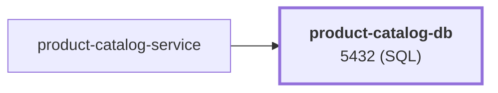

# product-catalog-db

database · platform-demo

> **Temporary.** This image is hand-built, has no pipeline and no signature. Its `StatefulSet` stays in the cluster for now: the shop is going to move to another cluster later, so it is not replaced by Amazon RDS (the only RDS database is the one behind Backstage). Until then the Helm chart, the allow-list entry in the Helm CI and the Kyverno PolicyException stay.

Runtime<strong>PostgreSQL 17</strong><small>SQL</small>

Listens on<strong>5432</strong><small>SQL</small>

State<strong>Stateful</strong>

Image<strong>product-catalog-db</strong><small>mladenovskistefan/</small>

## Where it sits

Called by `product-catalog-service`. It has no downstream dependencies.

## At a glance

| | |
|---|---|
| **Engine** | PostgreSQL 17 (`postgres:17`, currently 17.9 on Debian) |
| **Image** | `mladenovskistefan/product-catalog-db` (tag `latest`; consider pinning) |
| **Port** | `5432` (PostgreSQL wire protocol) |
| **Data directory** | `/var/lib/postgresql/data` (`PGDATA` is set to this in the image) |
| **Init script** | [`dump.sql`](https://github.com/platform-boutique/app-product-catalog-db/blob/main/dump.sql) → `/docker-entrypoint-initdb.d/001_init.sql` |
| **Health** | `pg_isready -U <user> -d <db>` |
| **State** | Yes — needs a persistent volume |
| **Called by** | `product-catalog-service` (read-only `SELECT`s) |
| **Image size** | ~161 MB |

## Find it elsewhere

<h4><a href="https://argocd.platform-demo.click/applications/argocd/dev-product-catalog-db">Argo CD</a></h4>
Sync and health of <code>dev-product-catalog-db</code>.

<h4><a href="https://github.com/platform-boutique/app-product-catalog-db">Repository</a></h4>
Source, pull requests and releases of <code>app-product-catalog-db</code>.

!!! info "Part of the platform-demo platform"
    Cross-cutting facts (service wiring, observability contract, Kubernetes translation, CI/CD) are in the
    [master reference](https://github.com/platform-boutique/platform-demo-docs). This site only describes product-catalog-db.
